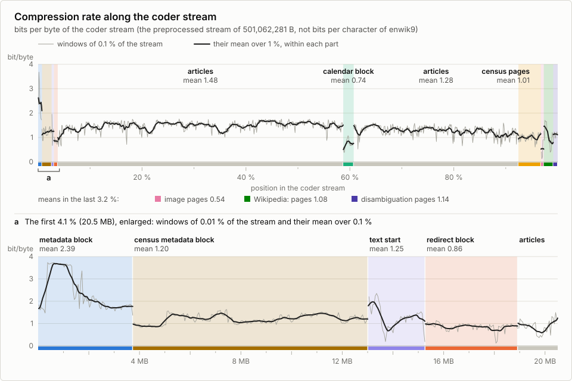

# cmix-neif-3.1: optimized fork of cmix-neif-2.0 (Hutter Prize entry)

**Latest optimizations & release (`cmix-neif-3.1`): Oleksandr Dreval (<https://github.com/OleksandrDreval>), November 2026 — based on `cmix-neif-2.0` by Marcus Wölk, Ellefeld, Germany.**

* Version: `cmix-neif-3.1` (<https://github.com/OleksandrDreval/cmix-neif-3.1>)
* License: **GNU General Public License v3.0 only (`SPDX-License-Identifier: GPL-3.0-only`)** — OSI-approved & Free Software license (see `LICENSE` and `AUTHORS`)
* Fork base: `cmix-lex`
* Previous versions: `cmix-neif-2.0` (Marcus Wölk, 30 October 2026) and `cmix-neif-1.0` (Marcus Wölk, 5 October 2026, <https://github.com/marwoelk/cmix-neif-1.0>)

`cmix-neif-3.1` preserves the complete compression pipeline of `cmix-neif-2.0` while applying four iterations of surgical, zero-retraining optimizations by **Oleksandr Dreval** (documented in `CHANGES.md`, `en-optimization_report_it_1.md`, `en-optimization_report_it_2.md`, `en-optimization_report_it_3.md`, `en-optimization_report_it_4.md`, `uk-optimization_report_it_1.md`, `uk-optimization_report_it_2.md`, `uk-optimization_report_it_3.md`, and `uk-optimization_report_it_4.md`): (1) fixing the self-extracting stub warm-up copy order for user-space syscall interception (`systrap`), re-tuning stage-1 bootstrap CM weights, and introducing single-pass forward `cm_compress_k` (`K = a.outn + 4` at `i == nd`) packing (`9.12 GiB` -> `1.51 GiB` peak packer RSS, `~38.0 s`, zero unpacker runs), (2) Sign-Magnitude / per-tensor context / 16-bucket node-aware width context `b` / 5-way `ENC_INT4W` magnitude probability mixing (`p_tree`, 2D/3D spatial contexts with RoPE parity `k & 1`, Bayesian row-column posterior `p_rc`, leaf QAT off-grid rate `p_grid` on `(p_tree + p_rc) >> 1`) / per-row QAT-grid flag `gbit` (`zr_ctx[kNamenN * 4]`) skipping the 3rd magnitude tree level (`bit_k = 0`) on `{0, ±2, ±4, ±7}` rows / 4-way `ENC_INT4W` sign mixing with magnitude-weighted positive-dipole posterior (`tailB = 0 B` full Lehmer Stream-B absorption) / `ENC_BF16C` row-$L_2$-energy-bucket & `ENC_F32HC` column-bucket `prev_hi` & lo-byte mixing / header byte-role & adaptive `cname` mixing / QAT-prior / cross-tensor warm-start / `last_zrow` + fast-weight-preserving coupled exact-$L_2^2$-norm feature-Gram `mlp.up` (`blocks.6..11`) and closed-form analytical $\text{ReLU}^2$ cross-covariance-compensated `mlp.down` (`blocks.4..15`) snapping onto the true 4-level QAT grid `{0, ±2, ±4, ±7}` (`qat-snap`, `3,744,629 B` -> **`3,512,771 B`**, **`-231,858 B` per copy / `-463,716 B` in `S`**), (3) slot-1 3-bit mantissa rounding, single-byte `(e_code << 4) | s` `kBlobW[24669]` packing (`49,158 B` -> `24,669 B`, `-24,489 B` `.rodata`, `-49.8 %`) with 90-byte exception tail, pruning of 39 dead training fields from `struct Head`, dead-code pruning, and a 100 % IEEE-754 bit-exact frozen active-cell AVX2 fast-path (`H = kSlotH[slot]`: `Dot16Preloaded` for slot 0 and `Dot32Preloaded` for slots 1–2 + transposed non-FMA `hidP`) in `BITLSTM`, (4) ~2.86x runtime peak RAM reduction (`9.77 GiB` -> `~3.34 GiB`) across the `PPMd` page pool (`zonen_textrahmen` 4 MiB fix, removal of phantom `+2.12 GiB` `ppmd_page::raum` pre-charge, demand-paged `memfd`), single-mapping demand-paged `SEMCACHE` (`MAP_NORESERVE` + `FreeFxcmRest` `munmap` with exact `kNLog = 24, kB = 18` SimHash geometry), `word_label` 69 MiB memory-leak fix and `PAGE_REGISTRY_ADD` cleanup, and 4 KiB demand-paged `arena` / `HugeBuf` allocators plus AVX2 vectorization in `SemDotPm1` and `mixer_precond`, and (5) compiler warning and PGO diagnostic cleanups across `src/` and `makefile`. Sections 3 and 4 below retain the upstream `cmix-neif-2.0` architectural documentation and measurements against `cmix-neif-1.0`.

## The Hutter Prize

The **Hutter Prize for Lossless Compression of Human Knowledge** has run since
2006 and is funded by Professor Marcus Hutter. It rewards progress in
compressing `enwik9`, the first 10^9 bytes (1 GB) of the XML text dump of the
English Wikipedia of 3 March 2006. The contest began on the 100 MB file `enwik8`
with a fund of 50,000 euros; in 2020 both were raised tenfold, to `enwik9` and
500,000 euros, with 5,000 euros paid for each percent of improvement.

Its premise is that text compression and artificial intelligence are the same
problem. To compress text well a program has to predict it well, and to predict
it well it has to model the knowledge and the structure that the text
expresses, which is why the organizers describe compressing natural language as
an AI-hard task. The exact number of bytes a program needs to reproduce the text
is therefore taken as a measure of how well it models human knowledge, and the
contest exists to push that number down as a route towards general artificial
intelligence.

An entry must beat the current record by at least 1 % in `S`, the size of the
compressor plus the size of the self-extracting archive plus the length of any
command-line options needed for execution or compilation. Each program must run
on one CPU core without a GPU, within 70,000/T hours, where `T` is the
Geekbench 5 single-core score of the machine it is measured on, inside 10 GiB of
memory and using at most 100 GB of temporary disk.

* Rules and current record: <http://prize.hutter1.net/>
* Background: <https://en.wikipedia.org/wiki/Hutter_Prize>
* Announcements and discussion: <https://groups.google.com/g/Hutter-Prize>
* Large Text Compression Benchmark and further reading, Matt Mahoney:
  <http://mattmahoney.net/dc/text.html> and <http://mattmahoney.net/dc/>

## Result

### Verified `cmix-neif-3.1` improvements against `cmix-neif-2.0` (Oleksandr Dreval)

| metric / component | `cmix-neif-2.0` baseline | `cmix-neif-3.1` (Iter 4) | delta / effect |
|---|---:|---:|---:|
| `.c5` transformer weight container (single / doubled in `S`) | 3,744,629 B / 7,489,258 B | **3,512,771 B** / **7,025,542 B** | **-231,858 B** per copy / **-463,716 B in `S`** (`-222,671 B` / `-445,342 B` vs Iter 3; `tailB = 0 B`, `K = 20,277 B`, FNV-1a-64 `0x844f1f2bf695ec2b`) |
| `BITLSTM` `kBlobW` `.rodata` & stripped ELF (`Nf` / `Nd`) | 49,158 B (`619,918` / `538,880` B) | **24,669 B** (`601,822` / `520,768` B) | **-24,489 B `kBlobW` (-49.8 %)** / **-18,112 B ELF** (`-18,640 B` vs Iter 3) |
| Packed compressor + decompressor (`cmix_orig + .decomp_bin`) | 395,323 B (211,438 + 183,885) | **397,117 B** (212,328 + 184,789) | `+1,794 B in S` (includes multi-model `.c5` decoder yielding `-463,716 B` in `.c5` savings; `-12,148 B` vs Iter 3) |
| Shipped `comp9` / projected `S = comp9 + archive9` | 4,042,564 B / 93,388,956 B | **3,811,596 B** / **92,927,013 B** | **-230,968 B** on `comp9` (`sha256 d5ac0170...`) / **-461,943 B in `S`** (`-460,872 B` vs Iter 3) |
| Peak resident set (RAM) on full `enwik9` | 9.77 GiB (9,770 MiB) | **~3.34 GiB (3,420 MiB)** | **2.86x lower RAM** (-6.20 GiB) |
| Packer build peak RSS & single-pass time (`build_packer.sh`) | 9.12 GiB / >300 s (`systrap` trap) | **1.51 GiB (1,543 MiB)** / **~38.0 s** (`204.0 s` full `build.sh`) | **6.05x lower build RAM**, `4.06x` faster vs Iter 2, `systrap`-safe |
| Single-core coding / decoding speed (representative slices) | baseline (1.00x) | **+10.8 % to +11.2 % faster** (`~2.7x` faster `BITLSTM` slot 0) | 100 % round-trip bit-identical |

### Upstream `cmix-neif-2.0` full `enwik9` reference run (baseline)

| quantity | value (`cmix-neif-2.0` baseline) |
|---|---:|
| `archive9`, self-extracting | 89,346,392 B |
| `comp9`, the compressor | 4,042,564 B |
| `comp9.args`, the command-line options of the compression run | 0 B (the compressor is started as `./comp9`, section 1.4) |
| **S = `comp9` + `archive9` + `comp9.args` (`2.0` baseline)** | **93,388,956 B** *(before `-461,943 B` weight/code/packer savings in `cmix-neif-3.1` -> **`92,927,013 B`**)* |
| margin `(L-S)/L` (`2.0` baseline) | 7.01 % against the last awarded record, `fx2-cmix-transformer` (Vladimir Ivanov, submitted 24 July 2026, awarded 30 September 2026, L = 100,424,672 B); 2.63 % against `cmix-neif-1.0` (submitted 5 October 2026, S = 95,914,051 B) and 1.39 % against `cmix-neif-beehive` (Vladimir Malinovskii, submitted 23 October 2026, S = 94,705,591 B as stated in its submission) |
| wall clock (`2.0` baseline, section 1.2) | compression 49.18 h, decompression 49.3 h |
| peak resident set | **`~3.34 GiB` in `cmix-neif-3.1`** (reduced from 9.77 GiB compression / 9.75 GiB decompression in `cmix-neif-2.0`) |
| free disk | about 13 GB (section 1.1) |
| test machine | Google Cloud `c2d-highcpu-8` with one thread per core and a local NVMe SSD (section 1.2) |
| Geekbench 5 single core, `T` | 1,284, limit 70,000/T = 54.52 h for each program (section 1.2) |
| sha256 `comp9` / `archive9` (`2.0` reference) | 976bf2d309707ab555e0c92720da5508ff0e5e6b846fc7082234262b06767f82 / 88dd7087404122d010261e6855afd88875d34dde1f0539377d3e832fc0f6b3fd |

The transformer weights are a compressed container of 3,512,771 B in `cmix-neif-3.1`
(re-encoded with multi-model probability mixing, per-row `gbit`, and fast-weight-preserving
analytical $\text{ReLU}^2$ covariance-compensated `qat-snap` from 3,744,629 B in `cmix-neif-2.0`;
sha256 `cda620662f617c81ceaba2559ea79db7acd179d12399e451c516fb5a126ff2fe`). It is
appended to both executables and therefore counts twice in `S`; each program
writes it out of its own image at start-up. The three weight sets of BITLSTM,
24,579 weights in bfloat16 (packed into 24,669 B in `kBlobW` via single-byte
`(e_code << 4) | s` encoding with 90 exception exponents in `cmix-neif-3.1`,
down from 49,158 B in `cmix-neif-2.0`), are compiled into the program and count
twice as well.

## Overview

`cmix-neif` is a fork of `cmix-lex`. Its first version, `cmix-neif-1.0`, kept
the architecture of the fork base, with XML-aware preprocessing, a
word-replacing dictionary transform, a large bank of context models mixed by a
two-stage neural mixer, an arithmetic coder and a self-extracting archive, and
added a pre-trained transformer byte model, the correction model BITLSTM behind
the mixer, a page form of the stream with a metadata block at its head, a PPMd
model paged by the program itself and its own packer. Its README describes
these parts. This version keeps them and changes the following.

1. **SEMCACHE, a semantic cache over the states of the transformer** (sections
   3.2 and 4.1). Where the transformer is unsure of the next byte, SEMCACHE looks
   for earlier positions of the stream at which the transformer was in a
   similar state and predicts from the bytes that followed there. It is filled
   from coded bytes only, so the decompressor builds the same memory and the
   archive carries nothing for it. In a pair of full runs with and without it,
   both with BITLSTM learning online, `S` was about 730 KB (0.77 %) smaller
   with it. It holds about 2.2 GB of memory and costs an estimated 4.5 to 5.5
   hours of run time.
2. **A census transform over whole page templates** (sections 3.3 and 4.2). The
   machine-written articles on US places from the census of 2000 follow one
   template per kind of place. Each such page is split into the parts of its
   template, its values and the text that deviates from the template. Template
   choices and values move into a census metadata block behind the metadata
   block, where a number model of its own codes each value against an
   estimate; the page keeps only the deviating text and the names. The census
   pages take 21.7 MB of the coder stream instead of 79.1 MB, the census
   metadata block 9.3 MB.
3. **The transformer form of `cmix-neif-beehive`** (sections 3.1 and 4.3).
   Vladimir Malinovskii's `cmix-neif-beehive`, a fork of `cmix-neif-1.0`
   submitted on 23 October 2026, brought a new transformer architecture and
   training recipe. This entry ports the new parts of its inference engine,
   starts from its weights and trains them further on the coder stream of this
   version, at the attention window of 2048 of `cmix-neif-1.0`
   (`cmix-neif-beehive`: 1536).
4. **A new start of the text and reversible text rules** (sections 3.4 and
   4.4). Behind the two metadata blocks the text begins with three articles
   that the stream did not hold as text before, namely the dictionary, the
   names of the contributors and a pseudo-article of the census block. In the page text,
   three reversible rules remove what the decompressor can restore (the choice
   between `a` and `an`, repetitions of the page title, and link texts that
   follow from the link target).
5. **BITLSTM in three frozen parts** (sections 3.5 and 4.5). BITLSTM has three
   weight sets, one with 16 cells for the two metadata blocks and two with 32
   cells instead of 16 for consecutive parts of the text. Each set was trained
   offline on a graphics card, and none of them learns while coding.
6. **A new packer** for the self-extracting stub (section 4.9). On the same
   program it is 18,665 B of `S` smaller than the packer of `cmix-neif-1.0`
   and 232,381 B smaller than UPX, the packer of the fork base.

The small online byte LSTM beside the transformer and its PPMd prior are
removed, and the run time they took goes to the transformer and to SEMCACHE.
The coder stream shrinks from 552,750,198 B to 501,062,281 B.

![Layout of the coder stream of this version, to scale, with a thin bar of the stream of cmix-neif-1.0 for comparison. The metadata block and the census metadata block are followed by the three articles of the text start, the redirect block, the articles with the calendar block, the census pages, the image pages, the pages of the Wikipedia namespace and the disambiguation pages. The start and the end of the stream are enlarged. Bands below the bar mark the parts of BITLSTM and the zones in which the transformer and SEMCACHE run.](doc/stream_layout.svg)

## Contents

* [1. Quick start on a clean machine](#1-quick-start-on-a-clean-machine)
* [2. Lineage and attribution](#2-lineage-and-attribution)
* [3. Changes against cmix-neif-1.0](#3-changes-against-cmix-neif-10)
* [4. How the new components work](#4-how-the-new-components-work)
* [5. Training of the pre-trained parts](#5-training-of-the-pre-trained-parts)
* [6. Further optimisation opportunities](#6-further-optimisation-opportunities)
* [7. Files in this package](#7-files-in-this-package)
* [8. Closing remarks](#8-closing-remarks)
* [9. License](#9-license)

---

## 1. Quick start on a clean machine

### 1.1 Prerequisites

| item | requirement |
|---|---|
| platform | Linux, x86-64 |
| reproducible build | Ubuntu 24.04 LTS. `install.sh` installs clang, lld and llvm 18 (18.1.3), gcc 13 (13.3.0) and the other build packages in the versions of the Ubuntu archive snapshot it names; with that package state the build reproduces the published `comp9` byte for byte. On other systems, install the tools listed in `install.sh` by hand and run `build.sh` |
| instruction set | **AVX2 and FMA required** (`x86-64-v3`). There is only this code path, and a build without AVX2 stops with an error |
| toolchain | clang, lld and llvm, major version 18, for the program; gcc 13 for the second stage of the packer stub. Another major version produces a different binary |
| runtime | the shared libraries libc (GLIBC 2.34 or later), libstdc++ and libm; Ubuntu 24.04 provides them |
| RAM to run | peak resident set of **~3.34 GiB** in `cmix-neif-3.1` (down from 9.77 GiB in `cmix-neif-2.0`, well below the 10 GiB the rules allow); the reference test machine had 16 GiB and no swap |
| RAM and disk to build | a peak resident set of about 4.3 GiB, nearly all of it in one helper process that runs after the parallel compile steps (`make -j`) and briefly creates the sparse page file of the PPMd model; about 41 MB of disk, counted as allocated space, the unpacked package included; about 4 minutes on an Intel Core i9-13900 with 32 threads; the build does **not** need `enwik9`, the finished profile ships with the package |
| free disk to run | about 13 GB in the working directory at the peak of the compression, counted as allocated disk space; the decompression needs less (computed from the files it keeps). The largest file is the page file of the PPMd model, 14,000 MiB apparent, written sparsely and removed at the end (section 4.8); counted by apparent file size, the compression needs about 21 GB. In addition, unnamed temporary files are created with `tmpfile()`, which places them in `/tmp` whatever `TMPDIR` says. In one of them both programs keep a copy of the coder stream for the link context of the transformer, about 0.50 GB at the end of the stream. During its preprocessing step the compressor writes the pages and the metadata block to two more, 0.79 GB and 0.025 GB, and then the output of the dictionary transform to a third, 0.50 GB; all three are closed before the coding starts |
| input | `enwik9`, exactly 1,000,000,000 B, sha256 159b85351e5f76e60cbe32e04c677847a9ecba3adc79addab6f4c6c7aa3744bc |
| network | not needed after `install.sh`; the build is offline, and neither program opens a connection |

**Self-containment.** Apart from `enwik9` on the compression side, neither
program reads a file it did not write itself, except for its own image and the
two `/proc` entries named in section 1.5. Dictionary hints, article order and
the transformer weight container are appended blocks inside the executables,
and the three weight sets of BITLSTM are part of the program. Each program
unpacks the blocks it needs from its own image at start-up into the current
working directory and checks a stamped fingerprint over the container bytes
before the model is used. The dictionary reaches the decompressor as the first
article of the coder stream (section 4.4), so `archive9` holds no separate
dictionary block. `archive9` alone in an otherwise empty directory decodes.

### 1.2 Run times

Compression and decompression were run in the Judging Assistant on one
Google Cloud machine. The times are wall clock as the Assistant reports them.

| machine | processor, memory, working directory | Geekbench 5 single core, `T` | limit 70,000/T | compression, wall clock | decompression, wall clock | conditions |
|---|---|---:|---:|---:|---:|---|
| Google Cloud `c2d-highcpu-8` with one thread per core, the test machine of the result table | AMD EPYC 7B13 (Zen 3), 4 cores, 16 GiB; local NVMe SSD, 375 GB | [1,284](https://browser.geekbench.com/v5/cpu/24757986) | 54.52 h | 49.18 h | 49.3 h | Judging Assistant (commit 2820606), source-only, serial, in its container with one CPU and 16 GiB |

The Judging Assistant measured `T` itself with Geekbench 5.5.1 in its
container before the compression; the same value sets the limit of the
decompression. This run used an earlier build of the same configuration,
`comp9` sha256 70534f882ceff9bd5f83925c6cee5f63287b512e6cc466e8bb8fd21a132d3646
(4,072,107 B); the times, the peak resident set and the free disk of the
result table come from this run. The coded output of this run is identical byte for byte to that of the submitted `comp9`; the two archives differ only in the decompressor at their start and in the size fields at their end (16 B in this run, 8 B in the submitted `archive9`).

The decompression runs the same models over the same coder stream as the
compression and takes about as long.

The run can be repeated with the launcher of the Judging Assistant
(<https://github.com/jabowery/HutterPrizeJudgingAssistant>, commit 2820606). The
entry directory holds the source package `cmix-neif-3.1.tar.gz` and its
`entry.env`, without `archive9`. The launcher then runs the Judging Assistant
in source-only mode, which builds `comp9` from the package, compresses `enwik9`
and afterwards decompresses the generated `archive9`, one program at a time.
`PROJECT_ID` stands for the Google Cloud project.

```
git clone https://github.com/jabowery/HutterPrizeJudgingAssistant.git
cd HutterPrizeJudgingAssistant
git checkout 2820606bc078b545bbeeb65f2b806670762af0af
./launch-cloud-judging.sh \
    --project PROJECT_ID \
    --instance-name hpja-3p1-c2d8 \
    --repo-ref 2820606bc078b545bbeeb65f2b806670762af0af \
    --machine-type c2d-highcpu-8 \
    --threads-per-core 1 \
    --local-ssd-nvme \
    --boot-disk-size 90GB \
    --region us-east1 \
    /path/to/entries/cmix-neif-3.1
```

With `--threads-per-core 1` the instance has 4 vCPUs on 4 physical cores and
16 GiB of memory. `--local-ssd-nvme` attaches one local NVMe SSD of 375 GB,
which a startup script formats and mounts as the working directory of the
Judging Assistant. The launcher created the instance in zone `us-east1-b` with
the `gcloud` command shown in section 1.2 of the README of `cmix-neif-1.0`,
under the instance name of the baseline run. At this commit the Judging Assistant runs
a source-only entry in serial mode and under the `process-tree` execution
policy, and it evicts the input file of each program (`enwik9`, then
`archive9`) from memory before the program starts, all without further
options. In the measured `cmix-neif-2.0` baseline run the entry directory held, in place of the source
package, a package with the earlier `comp9` named above, whose `build.sh`
copied that file instead of compiling it.

### 1.3 Build

```
git clone https://github.com/OleksandrDreval/cmix-neif-3.1.git
cd cmix-neif-3.1
bash install.sh
bash build.sh
```

`install.sh` is the **only** step with root rights and network access. It
installs system packages and compiles nothing; it is non-interactive, and a
second run changes nothing.

`build.sh` runs **offline and without root**, in a copy of this directory. It
does the profile-guided compilation with link-time optimization, strips and
packs the binary with the self-extractor contained in this package, and appends
the build inputs. It writes `comp9` into the current working directory. Both
scripts exit non-zero on any failure and can be re-run.

### 1.4 Compress

In a directory that contains `enwik9`:

```
./comp9
```

Without arguments `comp9` reads `enwik9` and writes `archive9` into the
working directory; `./comp9 -e enwik9 archive9` does the same. The run takes
49.18 h on the test machine of the result table.

The program prints its steps and, while it codes, a progress line in percent.
The run time is **not linear** in that progress. A message about a failure
prints a code `E<n>`; `ERRORS.md` lists the codes with their texts.

### 1.5 Decompress

Copy `archive9` into an empty directory and run it there:

```
mkdir out && cp archive9 out/ && cd out
./archive9
```

`archive9` takes no arguments. It writes `enwik9_uncompressed`, whose content is
identical to `enwik9` (`data9` in the Hutter Prize rules). The run takes
49.3 h on the test machine of the result table.

Both programs read two files under `/proc`. `/proc/self/exe` is required,
because the packed image finds its own bytes through it; without it the program
stops at once with a non-zero status. `/proc/self/statm` sizes the page pool of
the PPMd model (section 4.8); if it cannot be read, the program prints one line
on stderr and the pool keeps its current size (1 GiB if `statm` is unreadable
from the start). The output is the same byte for byte in every case, but the
run can be slower.

### 1.6 Verify

```
cmp /path/to/enwik9 ./enwik9_uncompressed    # must print nothing
```

`S` is the size of `comp9` plus the size of `archive9`; `comp9.args` is empty.
The sha256 sums of `comp9` and `archive9` are in the result table. While either
program runs, `grep Threads /proc/<pid>/status` shows 1.

### 1.7 Determinism and the pinned build

The archive decodes only if the decompressor computes bit for bit the same
floating-point values as the compressor. As in `cmix-neif-1.0` (section 1.7
of its README), every unit is compiled for one target instruction set
(`-march=x86-64-v3`) without CPUID dispatch, the program uses its own
transcendental functions, with the exceptions named below, and fixed
floating-point semantics per unit
(`-ffp-model=fast -mrecip=none`, and `-ffp-model=precise -ffp-contract=off`
for the transformer, BITLSTM, the adaptive-depth stage and the other
numerically sensitive units), no reciprocal estimates, one thread and fixed
seeds. New in this version are
SEMCACHE and its end stage, which compute in integers and in double precision,
and an own `log1p` for the second end stage (section 4.1). It follows fdlibm
with the fused multiply-adds of the x86-64 FMA variant of glibc 2.39 and gives the same bits
as that variant for every single-precision input between -1 and 1 (checked
exhaustively); glibc versions without that variant, such as 2.35 of Ubuntu
22.04, compute `log1p` differently on processors with FMA. Four functions come
from the system maths library. The transformer calls `sincosf` only for
positions beyond its rotary table of 131,072 entries, which the pieces fed to
it do not reach. The number coder of the census metadata block calls `cos`,
`log2` and `log10` in double precision, in the compressor and in the
decompressor with the same arguments. `cos` enters the distances between
places (the nearest places and the order of the county candidates), `log2`
the scale class of an estimate and `log10` the number of decimals of the grid
of a value. In the compressor, all calls
of these functions and of `strtod`, `snprintf` with a floating-point
conversion and `rand` fall before the end of the census metadata block. They
were recorded in a compression of `enwik9` with glibc 2.39 and recomputed on a
processor with FMA with glibc 2.34 (AlmaLinux 9), 2.35 (Ubuntu 22.04), 2.36
(Debian 12), 2.39 (AlmaLinux 10), 2.41 (Debian 13), 2.42 (Ubuntu 25.10), 2.43
(Ubuntu 26.04, Fedora) and 2.44 (Arch Linux). All results agreed bit for bit,
except 128 of the 1,368,921 `log2` results of glibc 2.35, which has no FMA
variant of `log2`; they differ in the last bit, and none of them changes the
scale class the number coder derives from it. Every `qsort` call recorded in
that compression ordered its array exactly as a heap sort and a stable merge
sort did. The other sort sites, one at the end of the text start and three
that only the decompressor runs, compare by the whole element or by unique
keys, so no order depends on the sort algorithm of the C library.
A compression of `enwik9` with glibc 2.35 wrote the same coder stream and the
same first 3 MiB of `archive9`, which reach past the census metadata block, as
a compression with glibc 2.39.

The profile of the profile-guided build ships in `pgo_data/`, so a build from
this package with the pinned toolchain produces the `comp9` whose sha256 is in
the result table, also on other machines (section 9). A different compiler can
produce a `comp9` of slightly different size and a slightly different
`archive9`. The submitted `archive9` carries its own decompressor, so it
decodes whatever compiler built the `comp9` that wrote it. Like `comp9`, it
uses the C library and the maths library of the system (section 1.1 and above).

### 1.8 Self-extraction

Both executables are packed with the self-extractor in `tools_src/packer/`,
which `build.sh` builds offline (section 4.9). At start the stub unpacks the
program into an anonymous memory file and starts it (`memfd_create`,
`execveat`). Without `memfd_create` the stub stops with a non-zero status; it
writes no file.

Unpacking takes about 52 s for `comp9` and 45 s for `archive9` on one core of
an AMD EPYC 7502P (Zen 2), with a peak resident set of about 1.5 GiB, which
stays below the peak of the program itself. The compressor starts its own
image twice more through the C library's `system()`, which runs a shell, to
decode its two embedded blocks (mode `-D`); each start unpacks the program
again. The decompressor starts no further process. Apart from that shell,
neither program starts a program other than its own image. Because of these
child processes, the entry needs the `process-tree` execution policy of the
Judging Assistant.

---

## 2. Lineage and attribution

`cmix-neif-3.1` (optimized in November 2026 by **Oleksandr Dreval**,
<https://github.com/OleksandrDreval>, repository
<https://github.com/OleksandrDreval/cmix-neif-3.1>) is a modified derivative of
`cmix-neif-2.0` (Marcus Wölk, 30 October 2026), which in turn is a modified
version of `cmix-neif-1.0` (<https://github.com/marwoelk/cmix-neif-1.0>, commit
`1c9ea5ed`), whose fork base is `cmix-lex`. Section 2 of the README of
`cmix-neif-1.0` gives the line of descent from `cmix` to `cmix-lex` and the
origin of every part kept from it; that attribution is unchanged and is not
repeated here. `AUTHORS` and `NOTICE.md` list all authors and borrowed parts
with origin and licence, and `training/ATTRIBUTION.md` lists those of the
training. The comment column of the tables in section 3 names the origin of
each borrowed change, and section 9 gives the licences.

New in this version are parts of two published forks of `cmix-neif-1.0`.

* **`cmix-neif-beehive` (Vladimir Malinovskii)**,
  `github.com/galqiwi/cmix-neif-beehive`, commit `92c07c0b`, GPL-3, a fork of
  `cmix-neif-1.0` submitted on 23 October 2026. From it come the architecture
  and the training recipe of the transformer (attention residuals, one key and value
  head shared by all heads, value embeddings, an MLP width of 1024, a head that
  adds the logits of the prior to the output, weight rows of 2, 3 or 4 bits,
  quantization-aware training with a size term as a cool-down phase), the
  parts of its inference engine that
  implement them, the prefetch depth of the dense kernels, the confidence of
  the transformer as context of a layer-0 mixer, the training scripts on which
  the trainer of this entry is built, and the weights from which the training
  of the shipped weights started (sections 3.1, 4.3 and 5). The
  shared key and value head, the value embeddings, the MLP width and the
  prior-logit head are options of the training code of Vladimir
  Ivanov's `fx2-cmix-transformer` that the configuration of `cmix-neif-beehive`
  switches on.
* **`ex-girlfriend 1.0` (Ryan Landay)**, `github.com/rlanday/ex-girlfriend`,
  commit `e923faec`, GPL-3.0-only, a modification of `cmix-neif-1.0`. From it
  come the forecast of the revision id from the page id below revision id 17,000,000 in
  part A of the metadata block, the timestamp forecast from the slope of the
  last records above the fixed rank of part B, and the fast-weight head, a
  second transformer distribution from weights learned online in the MLP
  blocks 12 to 15 (sections 3.1 and 3.4).

From outside the program family, new in this version:

* the attention residuals of the transformer, after *Attention Residuals* of
  the **Kimi Team** (arXiv 2603.15031), through `cmix-neif-beehive`, with their
  depth mixture evaluated as the online softmax of **M. Milakov and N.
  Gimelshein** (2018), also through `cmix-neif-beehive`; one key and
  value head for all query heads, the multi-query attention of **Noam
  Shazeer** (2019), through `cmix-neif-beehive`;
* the value embeddings of the transformer (a learned embedding of the token
  mixed into the values of an attention layer), introduced by **Braden
  Koszarsky** in the NanoGPT speedrun of Modded-NanoGPT (record of 4 December
  2024), through `fx2-cmix-transformer` and `cmix-neif-beehive`; the README of
  Modded-NanoGPT names the value residual learning of **Zhanchao Zhou et al.**
  (2024) as their inspiration;
* for the container of the transformer weights, the factorial number system of
  a permutation of **C.-A. Laisant** (1888), known as the Lehmer code, and the
  bits-back argument of **G. E. Hinton and D. van Camp** (1993), methods only;
* for SEMCACHE, the nearest-neighbour language model of **Khandelwal et al.**
  (2020), the continuous cache of **Grave, Joulin and Usunier** (2017) and its
  unbounded form with approximate nearest-neighbour search of **Grave, Cissé
  and Joulin** (2017), which predict from stored states and the tokens that
  followed them, random-hyperplane hashing
  (SimHash) of **M. Charikar** (2002), multi-probe hashing of **Q. Lv et al.**
  (2007) and, in its end stage, the AdaGrad step of **J. Duchi, E. Hazan and
  Y. Singer** (2011), all methods from the literature, implemented here
  without adopted code;
* the fixed share of the Bayesian term in the final mixer, like in **M.
  Herbster and M. K. Warmuth**, *Tracking the best expert* (1995);
* the ridge regression in the number coder of the census transform, after
  **A. E. Hoerl and R. W. Kennard**, *Ridge Regression: Biased Estimation for
  Nonorthogonal Problems* (1970);
* the function `log1p`, from fdlibm `s_log1p.c` 5.1 (**Sun Microsystems**,
  1993) with the polynomial evaluation for pipelined processors of **Naohiko
  Shimizu** (Tokai University, 1997), implementation adapted from glibc 2.39
  and its FMA variant (LGPL-2.1-or-later); the notice of Sun Microsystems is
  kept in the source;
* in the packer, the run map and byte history per context of `ContextMap2` in
  **paq8px** v217 (the run map as a state map by **Zoltán Gotthardt**), written
  anew with the index of the byte-history input in the form of paq8px, and
  indirect contexts over the instruction like the indirect context model of
  **Matt Mahoney's** paq8f (2006), written anew; for its first stage, context
  models over byte masks of the last bytes in the form of Crinkler (**Aske
  Simon Christensen, Rune L. H. Stubbe**), like in oneKpaq (**Teemu
  Suutari**), written anew;
* in the coder of the dictionary hints and the article-order residual, the
  squash function with interpolation, the stretch function as its inverse, the
  arithmetic coder and the counter rate of **Matt Mahoney's** `lpaq1`
  (GPL-2.0-or-later), adapted; the same squash table and stretch function in
  the sign rule of the census region;
* the generator xorshift64* of **Sebastiano Vigna** (2016, public domain),
  which multiplies the output of **George Marsaglia**'s xorshift (2003) by a
  constant from the tables of **Pierre L'Ecuyer** (1999), for the fixed random
  projections and hyperplanes of SEMCACHE, and its multiplier in the context
  hash of the first stage of the packer;
* the constant 0x9E3779B97F4A7C15, 2^64 divided by the golden ratio, as a hash
  constant in SEMCACHE, the census transform, the numbering of repeated edit
  comments and the first stage of the packer, as in the multiplicative hashing
  with the golden ratio described by **D. E. Knuth** (*The Art of Computer
  Programming*, volume 3, section 6.4);
* the multiplier of the MurmurHash3 finalizer (**Austin Appleby**) and the
  FNV primes (**Glenn Fowler, Landon Curt Noll, Kiem-Phong Vo**), both public
  domain, as multipliers in the context hash of the coder of the hint
  package, the FNV primes also in the first stage of the packer.

Because the small byte LSTM is removed, four borrowed parts of
`cmix-neif-1.0` are no longer used, the PPMd prior on its output logits (David
Freelan, `cmix-obias`), its block-diagonal recurrence (Xeloraa), its
eight-wide `tanh` with the Cephes polynomial and the xxHash32 steps in its pair
and triple hashes. The feed of its prediction into the text model (Kaido
Orav's wiring, in the form of Halvor Yttredal's `fx-deepmix`) is still in the
code and now carries a constant.

If anything is listed wrongly or a contribution has been overlooked in this
section, in `AUTHORS` or in `NOTICE.md`, please open an issue in the GitHub
repository of `cmix-neif-3.1`
(<https://github.com/OleksandrDreval/cmix-neif-3.1/issues>).

---

## 3. Changes against cmix-neif-1.0

Negative numbers mean smaller or faster. All figures are approximate. They come
from stream prefixes and windows, from full runs and from computations, from
different stages of development, and no item was measured against every
combination of the others. Combinations were repeatedly sub-additive, so **the
sum of these tables is not the difference between `cmix-neif-1.0` and this
entry**; that difference is the result table. Where a row says "estimate", the
figure was extrapolated or computed instead of measured; "at N %" means a full
run read at that share of the stream.

A change of the stream form changes the data the transformer is trained on, so
it has no figure of its own with the transformer. Rows of the stream form
therefore give the effect on the context models with the transformer switched
off ("without the transformer"); the result table holds the effect of all of
them together with the transformer trained on this stream.

Code and data that both programs need count twice in `S`, build inputs that
only the compressor needs count once. Each size cell says whether it refers to
`archive9`, to the binaries or to `S`. Time figures were measured during
development on several machines (AMD Zen 2 and Zen 3, Intel Core i9), partly as
wall clock and partly as instruction or cycle counts, or computed from them;
they show the order of magnitude and depend on the CPU.

The comment column names the origin wherever an idea or a piece of code came
from somewhere else, wholly or in part. Numerous small changes (renamings,
simplifications, error handling, console messages, removal of unused code,
small run-time and memory improvements) are not listed one by one; section 3.9
gives the size of the program with all of them.

### 3.1 The transformer

| item | what it does | size effect | time / RAM | comment |
|---|---|---|---|---|
| architecture of `cmix-neif-beehive` | 16 layers at d_model 192, of which 12 are linear-attention layers of the KDA type (Kimi Delta Attention) and 4 attend over a window, as in `cmix-neif-1.0`; new are attention residuals (each sublayer reads a learned softmax mixture of all earlier sublayer outputs in place of the running residual sum), one key and value head shared by all query heads, value embeddings in the four window layers, an MLP width of 1024 instead of 768, and a head that adds the logits of the PPMd prior to the output; 9,285,596 parameters (`cmix-neif-1.0` about 7.8 M) | the effect of the new transformer on its own was not measured (section 4.3) | about +9 % instructions per transformer row against the model of `cmix-neif-1.0` at the same window, about +1.3 h (computed) | architecture, recipe and start weights **adopted from Vladimir Malinovskii, `cmix-neif-beehive`**; attention residuals after the **Kimi Team** (arXiv 2603.15031), value embeddings after **Braden Koszarsky** (Modded-NanoGPT, 2024); the engine parts adapted from `cmix-neif-beehive` |
| training on this stream | the weights of `cmix-neif-beehive`, trained on the stream of `cmix-neif-1.0` and exported there at an attention window of 1536, were trained further on the coder stream of this version at the window of 2048 of `cmix-neif-1.0`, for 600 epochs in bfloat16, 96 epochs quantization-aware and 16 at full precision (section 4.3) | contained in the result | none | the recipe follows `cmix-neif-beehive`; the length of the quantization tail is this entry's |
| fast-weight head | a second distribution of the transformer from fast weights on the codes of the MLP blocks 12 to 15, learned online while coding, enters the mixer as a further expert | about -71 KB of `S` in a pair of full runs with the transformer of `cmix-neif-1.0`; about +4.9 KB of `S` for the code | about +1.0 to +2.2 h (computed) | **taken from Ryan Landay, `ex-girlfriend 1.0`** (its code adapted, four blocks as there) |
| container formats | the container of `cmix-neif-1.0` is extended by entropy coding of the weights, and the order of interchangeable groups of neurons is coded into the choice among their permutations (bits-back, Lehmer code), now also for the groups of the fast-weight MLP blocks and the key and value dimensions of the KDA layers; the step that removes dead MLP neurons runs as before and found none in this model | together about -43 KB of `S` (entropy coding -9.9 KB, permutations -20.2 KB, their extension -13.3 KB), each with a byte-identical archive | none | the archive does not change; only redundancy is removed |
| fed rows without digit-run classes | the rows that `cmix-neif-1.0` fed after each digit run (section 4.2 of its README) are no longer fed, and the special paths of the transformer for ISBN check digits are removed; the transformer reads the preprocessed stream as it is | part of the training form, no figure of its own | fewer fed rows | a change requires retraining |
| speed of the engine | rows whose output nobody reads are computed as a block of up to 16 rows; under the shared key and value head only head 0 prepares them; the depth mixture of the attention residuals runs as an online softmax; the dense kernels prefetch 6 KB ahead instead of 2 KB | all bit-identical; the block about +2.2 KB of `S`, the depth mixture about -0.3 KB of `S` | the block about -0.49 h, the depth mixture about -0.26 h (both computed from instruction counts); the prefetch depth reduced the cycles on Zen 3, its size was not separated | online-softmax depth mixture and prefetch depth adapted from `cmix-neif-beehive`; the block form is this entry's |

### 3.2 SEMCACHE

| item | what it does | size effect | time / RAM | comment |
|---|---|---|---|---|
| SEMCACHE | a memory of about 16.8 M transformer states at unsure positions of the stream, each with the byte that followed it; at a new unsure position the 32 most similar earlier states and the bytes that followed them give a distribution of the next byte, which feeds the mixers, four inputs of BITLSTM and an end stage in front of the coder (section 4.1) | about -730 KB of `S` (0.77 %) in a pair of full runs of this model with and without it, both with BITLSTM learning online in place of the three weight sets (coded output -743.6 KB); its code about +6.8 KB in each program, about +13.6 KB of `S` | about 2.2 GB of RAM, taken from the page pool of the PPMd model; about +4.5 to +5.5 h (estimate, computed from the cycles per lookup on AMD Zen 2 and the number of lookups on an earlier form of the stream) | methods after the literature named in section 2; design and code of this entry |

### 3.3 Census transform

| item | what it does | size effect | time / RAM | comment |
|---|---|---|---|---|
| census template form | the census pages are split into template parts, values and deviating text; template choices and values go into a census metadata block behind the metadata block, the page keeps the deviating text and the names (section 4.2) | census pages 79.1 MB of the stream in `cmix-neif-1.0`, now 21.7 MB (stubs and the pages that stay text) and 9.3 MB of block. Without the transformer, on four windows that cover 97.4 % of the census pages, about -129 KB of `archive9` for the first complete form; the code and tables of the census form of this version at least about +42 KB of `S` (zeroed in the final program, which was then packed again); in a form of `cmix-neif-1.0` with a byte LSTM of 256 cells in place of the transformer and BITLSTM with 32 cells learning online, full runs over all of `enwik9` give this form about -273 KB of `S` against no census transform and about -111 KB against the census form of `cmix-neif-1.0`, with its code in that program included | the coder stream about 47 MB shorter (this form against the census form of `cmix-neif-1.0`, both on the stream of `cmix-neif-1.0`), about -4.4 h (computed from the stream length) | replaces, for the pages of the template form, the number transform of `cmix-neif-1.0` |
| number coder | each value is coded as its distance to an estimate on the grid of the value; the estimate comes from an online ridge regression per kind of place over features of the record and from the mean of the eight nearest places of that kind coded before; in front of each value the field and a coarse scale class of the estimate are fed to the models as known bytes; members of county lists and neighbouring counties are value slots with short tokens, the category link to the own county repeats the county without a token, a repeated coordinate is a short token | without the transformer, on windows or on the block, about -32 KB for the scale class and about -26 KB, -37 KB, -18 KB, -10 KB and -4 KB for five further refinements of the census form (not additive) | small | the ridge regression after **Hoerl and Kennard** |
| census pseudo-article | the texts of all template variants, each once, and the words of the states and kinds of place, as a third article of the text start (section 4.4) | part of the forms above | none | |
| fed rows of a census page | in front of the title a context row with the words of the type and the state of the record; population and area in the page row; the population, households, families, housing units, areas, density, location and incomes of the record in sentences of the template wording, and the coordinates behind `located at`, as fed blocks | part of the training form, no figure of its own | fed rows take places in the attention window | |
| sign rule of the census region | a rule at the final probability in the census region | about -3.1 to -5.3 KB of `S` (estimate, measured on the census form of `cmix-neif-1.0`) | small | the squash table and the stretch function of **Matt Mahoney's** `lpaq1` |

### 3.4 Stream form: the text start and reversible text rules

Behind the metadata block and the census metadata block the text begins with
three articles, and three reversible rules shorten the page text. Section 4.4
describes both.

| item | what it does | size effect | time / RAM | comment |
|---|---|---|---|---|
| dictionary article | the words of the dictionary stand as the first article of the text, in code form, where a later word uses the codes of earlier ones; the decompressor takes its dictionary from this article; the PPMd model is warmed up with the codes in front of the article and with the word stems at its end | an empty line in front of each word out of alphabetical order about -3.1 KB on the article, without the transformer; the warm-up has no figure of its own (it can only be judged with a trained transformer) | none | |
| contributor article | the names of the contributors move from part B of the metadata block, which keeps a mark (new or repeated name) in their place, into the second article of the text, while anonymous addresses and a few names stay in part B; in front of each line of it the day of its revision and the kind of its mark are fed to all models as known bytes; the word-label model starts afresh behind it | without the transformer about -6.3 KB on 9 MB and about -5.9 KB on 50 MB of page text, against about +4.9 KB of code | none | |
| census pseudo-article | the third article, section 3.3 | | | |
| a/an | an indefinite article is written as the code of `a` where a rule on the following word (its first letters, with a list of 44 exceptions) gives the right form, and as the code of `an` where it does not; the decompressor applies the same rule | title and link shorten the stream by 4,880,702 B, a/an keeps its length; without the transformer at 11 % of a full run the three rules together with a stage for check digits about -8.1 KB against a run of the same stream length (a/an about -5.1 KB, title and link about -1.3 KB each, check digits about -0.4 KB); about +10.6 KB of code in `S` for the three rules | the stream about 4.9 MB shorter | |
| title | in the page text, the first bold `'''...'''` and the titles of interlanguage links that repeat the page title become a short copy mark | in the row above | | |
| link | a link whose shown text follows from its target (for example the target with the case of the first letter changed, or without a part in brackets) keeps the target and a short mark in place of the text | in the row above | | |
| ISBN-10 check digit | a correct check digit of an ISBN-10 leaves the stream and the decompressor computes it; a wrong one stays (in `cmix-neif-1.0` a rule moved the final probability towards the computed digit) | stream -34,737 B; code about +0.8 to +1.3 KB of `S` | none | |
| repeated edit comments | behind the redirect block, an edit comment that repeats an earlier comment of the same contributor becomes the number of that comment in the list of the contributor's comments; the comments of the redirect block stay text and enter no list | stream about -1.6 MB; without the transformer about neutral (estimate between -5.3 and +6.5 KB of `S`, code included) | the stream shorter | |
| computed values | values that follow from text already decoded (unit conversions, pairs of infobox fields, years) are fed to the transformer as a block with a copy mark and an end mark (section 4.4); the text itself stays unchanged | about -2.8 to -5.3 KB of `S` after training (estimate); about +8.8 KB of code | fed rows take places in the attention window | |
| link context | fixed rules choose the pieces of the link context (neighbouring rows, end token, redirects, page head, duplicates); in front of each piece the title of its source page; a block mark `#<word>` in front of the title by the position of the page in the order; a smaller index of the pieces | no figure without training | the index about -60 MB of RAM and about -1.6 % instructions | |
| word transform | partial-word codes of the dictionary transform only as prefixes and only from 7 letters on; no suffix codes | without the transformer at 11 % of a full run about -4.3 KB | none | |
| revision ids and timestamps | below revision id 17,000,000, part A of the metadata block codes the revision id as the remainder against an interpolation over the page id; above the fixed rank of part B, the timestamp forecast follows the slope of the last records | about -23 KB of `S` net of code (on the block); the stream about 0.16 MB shorter | none | **taken from Ryan Landay, `ex-girlfriend 1.0`** |

### 3.5 BITLSTM

| item | what it does | size effect | time / RAM | comment |
|---|---|---|---|---|
| three frozen weight sets | one weight set with 16 cells for the metadata block and the census metadata block, where BITLSTM was off in `cmix-neif-1.0`; one with 32 cells instead of 16 for the text up to the calendar block and one with 32 cells for the rest; the model switches at a boundary of 1,024 bits with its state set to zero, and it never learns while coding (`cmix-neif-1.0` learned online from 20 % of the stream on); the program has no backward pass | against no BITLSTM, about -12 KB of `S` in the metadata blocks, about -302 KB in the first part of the text and about -193 KB in the second, the weights counted twice (estimate from a replay of the trace, section 4.5); in two full runs of this model, about -109 KB of `S` against BITLSTM with 32 cells learning online | without a backward pass, against BITLSTM with 32 cells learning online, about -1.3 % of the instructions of this program and an estimated -0.4 to -1.6 h (from instruction and cycle counts on AMD Zen 2 over 2 MB of page text) | form, kernels and offline training on a trace **after David Freelan, `cmix-obias`** (published there as `bitlstm32`, with 32 cells) |
| new inputs | four inputs from SEMCACHE (its log-odds, its mass, the highest similarity, and whether its most probable byte is that of the transformer) and 12 inputs from the transformer (the fast-weight logit, the path state of its most probable byte in six classes, its confidence in four classes, and one more value of that state); the one-hot of the bit position now takes the true position of the bit in the byte; the sketch of the byte LSTM is gone | the SEMCACHE inputs about -12 KB at 11 % of a full run with an online BITLSTM; the transformer inputs not isolated | small | |
| training on a graphics card | a trainer in PyTorch replays the trace of a compression run of this configuration with 256 windows per Adam step and a cosine schedule of the learning rate (0.01 to 0.0001 for the metadata set, 0.003 to 0.00003 for the two text sets), followed by a fine-tuning on the rounded weights | about -1.9 KB against the C++ replay trainer of `cmix-neif-1.0` in a comparison on a short trace | none at run time | section 5 |

### 3.6 Mixer and context models

| item | what it does | size effect | time / RAM | comment |
|---|---|---|---|---|
| small byte LSTM removed | the online byte LSTM of 80 cells beside the transformer, its additional inputs and its PPMd prior are removed | about +6.4 KB of `S` (estimate from a full run read at 73 %); about -18.6 KB of `S` for the code | about -7 % of the instructions and an estimated -2.2 to -4.8 h (from instruction and cycle counts before and after the removal, on AMD Zen 2 over 8 MB of page text of an earlier form of the stream); its memory goes to other tables | the run time goes to the transformer and to SEMCACHE |
| Bayesian term and SSE mixing in the final mixer | a Bayesian mixture of four experts (transformer, fast-weight head, PPMd, text model) with a fixed share of 0.01 is an additional term of the final mixer; the final probability mixes the stretched SSE output and the mixer output at 0.4 to 0.6 | about -5.6 KB at 11.5 % of a full run | small | the fixed share like in **Herbster and Warmuth** |
| extra rows of the final mixer | 24 additional rows chosen by the path state of the most probable byte of the transformer (6) and its confidence (4), added to the selected row | about -3.3 KB at 11 % and about -6.4 KB at 30 % of a full run | small | |
| confidence of the transformer as mixer context | one layer-0 mixer selects its row by the probability of the most probable byte of the transformer in eight steps | not isolated | about +0.06 h (computed) | adapted from `cmix-neif-beehive` |
| mixer learning rates and normalisation | layer-0 mixers at 2.2 instead of 1.3 times the inherited rate, the final mixer at 5.0 instead of 0.75; the thresholds of the learning-rate schedule 16 times as long; the inputs of the layer-0 mixers normalised per column | each about -2.4 to -6.9 KB at 11 % of a full run with an online BITLSTM (not additive) | none | |
| floor and input clamp | the floor of the transformer probability lowered from 1e-6 to 3e-8, the clamp of the mixer inputs from 1e-4 to 1e-6 | the clamp at 1e-5 about -2.3 KB up to 18.7 % of a full run; the step to 1e-6 together with the floor about -0.4 KB at 11.5 % | none | |
| floor stage | a stage with a 32-bit probability behind BITLSTM, in front of the end stages of section 4.1 | about -5.5 KB of `S` in a pair of full runs | small | |
| adaptive depth | the threshold that skips the mixer cascade lowered from an absolute logit of 8 to 7 | about -4.1 KB at 30 % of a full run | about -0.75 % instructions | the mechanism is from **James Byrne's** `zmix 1.0`, as in `cmix-neif-1.0` |
| grammar automaton extended | seven more kinds of bits that the structure fixes are marked and not coded, about 89 M more bits | without the transformer about -2.2 KB at 11 % of a full run; about +1.3 KB of code | small | the automaton of `cmix-neif-1.0` (section 3.4 of its README) |

### 3.7 PPMd and memory

| item | what it does | size effect | time / RAM | comment |
|---|---|---|---|---|
| restarts around the census metadata block | the PPMd model starts empty at the end of the metadata block and again at the end of the census metadata block, at order 14 in both blocks; the paging layer is reset with it | about -0.4 KB on a prefix without the transformer; about +0.3 KB of code for the reset of the paging layer | the reset up to about -1 min | |
| start of the page pool | the page pool of the PPMd model starts at 1 GiB instead of 2 GiB, because SEMCACHE takes about 2.2 GB from the first byte of the stream on | none, the archive is the same for every pool size | lower at the start | |
| tables made resident at the start | the tables of SEMCACHE are written once at the first byte of the stream, behind room made in the page pool, and the end of the census metadata block steps the size control of the pool | about +0.1 KB of code | the tables make no jump in the resident set later in the run; without this, the first writes into the zero-filled tables made about 0.9 GB resident within 100 ms on a current kernel | |

### 3.8 Speed

The time limit decides how much model fits. The figures are computed from
instruction or cycle counts or from the stream length and do not add up; the
run time of the whole program is in section 1.2.

| item | time | comment |
|---|---|---|
| census template form, coder stream about 47 MB shorter | about -4.4 h | section 3.3 |
| small byte LSTM removed | about -2.2 to -4.8 h | section 3.6 |
| SEMCACHE with vector kernels, an exact reciprocal division and prefetching | about -2.3 h against its first form, within its own +4.5 to +5.5 h | section 3.2 |
| transformer rows in blocks, online-softmax depth mixture | about -0.49 h and about -0.26 h | section 3.1 |
| new transformer at the window 2048 | about +1.3 h | section 3.1 |
| fast-weight head | about +1.0 to +2.2 h | section 3.1 |
| BITLSTM without a backward pass | about -0.4 to -1.6 h | section 3.5 |

### 3.9 Packaging

| item | what it does | size effect | time | comment |
|---|---|---|---|---|
| new packer | the two stages of the stub coder are rebuilt (section 4.9) | -18,665 B of `S` against the packer of `cmix-neif-1.0` on the same program | unpacking about 52 s for `comp9` and 45 s for `archive9` on Zen 2 (section 1.8) | section 4.9 for the origins |
| size of the program | the packed program, the compressor part of `comp9` plus the decompressor at the head of `archive9`, is 395,323 B (`cmix-neif-1.0`: 348,267 B); SEMCACHE, the census transform, the text start, the text rules, the new parts of the transformer engine and three larger weight sets of BITLSTM in place of one are added, and numerous small changes make the code smaller (among them messages that print a code `E<n>` listed in `ERRORS.md`, an order of the functions in the link with similar code together and the hot functions of the profile first, and the removal of unused code, of 26 slots of the text model that carried a constant and of the fallback path of the PPMd model on a full model area, where the program now stops with an error code) | +47,056 B in all | the small changes together slightly fewer instructions | |
| dictionary in the stream | the dictionary travels as the first article of the coder stream; the compressed dictionary block of `archive9` and the helper start that coded it are gone | contained in section 3.4 | one helper start less | |
| hint package and order residual | the dictionary hints and the article-order residual are coded by a small context-mixing coder of their own; dictionary, order and payload stay the same | -12.8 KB of `S` | none | the coder after **Matt Mahoney's** `lpaq1` |
| no arguments | `comp9` started without arguments compresses `enwik9` into `archive9`, so `comp9.args` is empty | -178 B of `S` (19 B of arguments) | none | |

---

## 4. How the new components work

### 4.1 SEMCACHE

The transformer turns the text in front of each byte into an internal state
and predicts the next byte from it. Where it is sure, little is left to gain.
Where it is unsure, an earlier position at which its state was similar has
often continued in the same way, for example inside a name, a phrase or a
recurring sentence that lies outside the attention window or that training did
not teach the model. SEMCACHE keeps the states of earlier unsure positions
together with the byte that followed each one, and at a new unsure position it
reads which bytes followed the most similar states.

![SEMCACHE. The state of the last layer of the transformer becomes a key of 128 values, which is stored in a ring of 16.8 M entries and indexed in 16 hash tables. A lookup reads four buckets per table, filters the candidates by a short sketch, ranks the best 128 by the cosine and keeps 32 neighbours, which together with followed neighbours of earlier lookups give a distribution of the next byte. Three consumers read it, the mixers, BITLSTM and an end stage in front of the coder. Below, the place of SEMCACHE in the coding chain of each bit and its effect in a pair of full runs.](doc/semantic_cache.svg)

**When.** SEMCACHE runs at every byte of the stream where the transformer
predicts a byte of the text, outside the two metadata blocks. It looks up where
the transformer gives its most probable byte a probability below 0.99, and it
stores the position where that probability is below 0.95.

**Key.** The state is the vector of 192 values that the MLP of the last layer
of the transformer reads. A running mean of these vectors is subtracted (taken
over the first 2^20 lookups below 0.9 and then kept fixed); the result is
scaled to 8-bit integers, projected by a fixed random matrix of +1 and -1 to
128 values and scaled to 8-bit integers again. A key is stored in 4 bits per
value, 64 B per entry.

**Memory.** A ring of 2^24 entries holds the keys (1 GiB), the byte that
followed each (16 MiB) and its position in the stream (64 MiB); a ring of the
last 32 MiB of the stream holds the bytes behind them. Sixteen hash tables
index the ring. Each takes the signs of 18 fixed random projections of a key
as the number of one of 2^18 buckets, mixed with the previous byte of the
stream, and each bucket keeps its 15 newest entries with a sketch of 96 bits
(960 MiB). Together these are about 2.2 GB, written once at the first byte of
the stream (section 3.7).

**Lookup.** In each table SEMCACHE reads the bucket of the key and the three
buckets whose numbers differ from it in the least certain bits. The candidates
are filtered by the distance of their sketches, the best 128 are ranked by the
cosine of the full keys, and the 32 best that lie at least 1,024 bytes back in
the stream become the neighbours. A neighbour is weighted by its cosine at a
temperature of 0.02. The neighbours of the last four lookups below 0.9 are
followed byte by byte for up to 24 bytes, as long as the bytes behind them
agree with the stream, and join the neighbours of the current byte.

**Prediction.** For each bit, the neighbours whose next byte agrees with the
bits of the current byte coded so far give the probability of the bit. It
reaches the coder in three ways, as an input of the layer-0 mixers and of the
final mixer, as four inputs of BITLSTM, and through an end stage in front of
the coder. The end stage consists of three logistic models over 20 features
(among them the class of the highest similarity, the agreement with the
transformer, word start, the age of the neighbours and the previous byte),
selected by context cells and trained online with AdaGrad, and of a fourth one
that mixes their outputs into a correction of the final probability. A bit whose probability is at least 0.99 for one value skips
the end stage. Behind it a second small stage of 16 features, which reads
nothing of SEMCACHE, corrects the probability along the most probable byte of
the transformer.

**Examples.** The two figures below show SEMCACHE at single bytes of the
article text, with the values read in a compression run of this version by a
probe that leaves the coded output unchanged. On the page Brown Bear the
transformer and SEMCACHE both rank the plural `goats` first, which shares
the first two of the three bytes of its word code with the true `goat`, and
SEMCACHE gives `goat` 20 %, while the transformer does not have it in its
top 3. On the page Swingout the strongest neighbour stands 3,273 rows of the
transformer back in the same article, outside the attention window of 2,048
rows. The cost of the whole compressor comes from all its models together,
so its distance to the transformer alone cannot be read as the gain of
SEMCACHE at that byte.

![SEMCACHE at one byte of the page Brown Bear, stream byte 54,868,329. Top, the excerpt of the stream around the byte, the last of the three bytes of the word code of goat in sheep and goat herders. In the middle, the top 3 of the transformer alone and of SEMCACHE alone, with the plural goats first in both, which shares the first two bytes of its word code with goat, and goat at 20 % in SEMCACHE, and the cost of the byte for the transformer alone, SEMCACHE alone and the whole compressor. Bottom, the five strongest neighbours with their article, their distance back in the stream and their earlier text, two of them followed by goats, one by sheep, one by goat and one by chickens.](doc/semcache_brown_bear.svg)

![SEMCACHE at one byte of the page Swingout, stream byte 46,795,575. Top, the excerpt of the stream around the byte, the second of the two bytes of the word code of trade in the lead and follow may trade places. In the middle, the top 3 of the transformer alone, which expects drive, and of SEMCACHE alone, which gives trade 80 %, and the cost of the byte for the transformer alone, SEMCACHE alone and the whole compressor. Bottom, the five strongest neighbours with their article, their distance back in the stream and their earlier text, four of them followed by trade and one by drive; the first stands in the same article outside the attention window, the second and the third in articles on dance moves.](doc/semcache_swingout.svg)

**Effect.** In two full runs of this model with and without SEMCACHE, `S`
differed by about 730 KB, 0.77 % of `S` without it. Both runs used BITLSTM with
32 cells learning online in place of the three trained weight sets. These read
four inputs of SEMCACHE and do not run without it, so the submitted form has
no run without SEMCACHE. The gain per megabyte grows over the first 40 MB or so
of text, while the memory fills, and reached -1.9 KB per MB of stream between
42.5 and 57.5 MB. Its run time was not measured in the final form; computed
from the cycles per lookup on AMD Zen 2 and the number of lookups on an
earlier form of the stream it is about 4.5 to 5.5 hours.


Everything SEMCACHE stores comes from bytes already coded and from the state
of the transformer at those bytes, which the decompressor computes in the same
order. Both programs run the same machine code for it, with integer kernels in
AVX2 and an exact division by a reciprocal, so both sides compute the same
bits.

### 4.2 The census transform

Most census pages of `enwik9` are articles on places in the United States
that a program wrote from the census of 2000, under titles of the form `Place,
State`. Each kind of place (county, city, town, village, census-designated
place and others) follows one automatic form, a fixed sequence of sentences and
headings with values in fixed places. The article order puts 36,519 of the
243,425 pages of `enwik9` (172,277 without the redirect pages) into the class
of census pages. `cmix-neif-1.0` recomputed the numbers of census pages that
follow from other numbers of the same page. This version takes apart the
36,148 pages that follow the template form, 36,016 of them in that class and
132 that stand earlier in the stream; the other 503 pages of the class stay
text.

![The census transform on one page. Left, a census page of enwik9 with the values, the placeholders and the deviating text marked. Right, the stub in the stream with the deviating text and the names, the record in the census metadata block with state, type word of the title, flags, gap bits and values, three template texts of the census pseudo-article, and how the number coder estimates the values. At the bottom, the size of the census pages in the coder stream of cmix-neif-1.0 and of this version.](doc/census_transform.svg)

**Template.** The compressor cuts each page into units (lines, and sentences
outside links) and abstracts each unit. Numbers and list directions become
value slots, page name, state, title and postal code become placeholders, and
the name part of a state link becomes a text slot. Units of one sentence family form a
position of the template of their kind of place, and their abstracted forms are
the variants of that position. Only families that carry value slots or
placeholders, and the section headings of the program, count, and only if they
occur on at least 2 % of the pages of the kind;
everything else stays text, also recurring sentences written by people. The
compressor checks every automatic unit byte for byte (expansion equals
original).

**Census metadata block.** Behind the metadata block stands a block of
9,280,775 bytes. Its head holds the template forms, per kind of place its
positions, per position its variants and per variant the fields of its value
slots. A run follows with one byte for each page from the first to the last
page with a record; the byte names the kind of place of the record of that
page or marks a page without one.
Then come the records of the 36,148 pages that follow the template form,
grouped by kind of place and in page order within each kind. A record holds
the state, the type word of the title, per position a flag (absent, variant
n, or a list of instances), the gap bits that say where text stands between
two automatic units (stored as the XOR with a predicted bit), and the values.
The texts of all variants are written once into the third article of the text
start (section 4.4). The page itself keeps, as a stub, only the deviating text
and the names. The block is treated like the metadata block.
The PPMd model restarts before and behind it and runs at order 14 inside it,
the transformer is off, BITLSTM uses its weights for the metadata blocks, and
the adaptive-depth stage and the mixers have a zone of their own.

![Layout of the census metadata block, to scale, between the metadata block and the text start. The head holds the template forms of the eight kinds of place, a run names the kind of place of each page, and the records follow, grouped by kind. Below, the record of Pleasant Lake, Minnesota, as bytes, with the bytes fed to the models in front of its flags and values, the estimates and tokens of nine of its values, the list flag of a second record, and the four parts from which the decoder restores a page.](doc/census_block.svg)

**Number coder.** Each value is coded as its distance to an estimate, on the
grid of the value; a value that is a share of a known total is coded as a
count. Where a rule fixes the value, such as the population of the census
sentence that repeats the population of the first sentence, the token is
empty. The estimate comes from an online ridge regression per kind of place
and field over features of the same record (with the mean of a feature where it
is missing and an offset per state that decays), whose features include the
mean of the field over the eight nearest places of that kind coded before. In
front of each value the field and a coarse scale class of the estimate are fed
to all models as known bytes, and in front of a value without a field the
earlier value of the record that it most likely repeats. In front of the flags
of a record the models are fed the revision id and the day of its page from
the metadata block (coarse), and in front of each flag its position. The county
of a place is coded as its rank in a list of the county records of its state,
which starts with the counties of the nearest records of earlier kinds. The
members of the lists of places of a county and the neighbouring counties are
value slots with short tokens (the number of skipped members, the rank in the
order of the neighbours), and the category link to the own county repeats the
county without a token. A coordinate that repeats in a map link is a short
token.

**For the transformer.** The transformer never sees the census metadata block.
In front of the title of a census page it is fed a context row with the words
of the kind of place and of the state of the record and the page row with
population and area; behind the alias rows, the population, households,
families, housing units, areas, density, location and incomes of the record in
sentences of the template wording; and behind `located at` the coordinates of
the record with an end mark. All models are fed these coordinates, in degrees,
minutes and seconds and as a decimal pair in brackets, so that the match models
predict the coordinates that follow in the text from this copy. All of this is
derived from the block and costs no archive bytes. The third article of the
text start holds the texts of the variants and the words of the states and
kinds of place in code form (section 4.4).

**Effect.** The census pages took 79.1 MB of the coder stream of
`cmix-neif-1.0` and take 21.7 MB (stubs and the pages that stay text) plus
9.3 MB of block in this version;
these figures also contain the other changes of the stream form. Measured on
the stream of `cmix-neif-1.0`, the census form of this version alone makes the
coder stream about 47 MB shorter than the census form of `cmix-neif-1.0`, which
saves about 4.4 hours (computed from the stream length).
Without the transformer, the first complete form saved about 129 KB of
`archive9` on four windows that cover 97.4 % of the census pages; the
refinements of the census form in section 3.3 followed. The code and tables of
the census form of this version (template form, census metadata block, number
coder and pseudo-article) take at least about 42 KB of `S`, measured by zeroing
them in the final program and packing it again, which leaves out their calls
from other code.
In a form of `cmix-neif-1.0` with a byte LSTM of 256 cells in place of the transformer and BITLSTM with 32 cells learning online, full runs over all of `enwik9` give about -273 KB of `S` for this form against no census transform and about -111 KB against the census form of `cmix-neif-1.0`, with its code in that program included.
In that frame the pages that both census forms leave the same cost about 120 to
160 KB more with the form of this version (estimate from the coded size, which
the runs record every 0.01 % of the stream). About 50 to 90 KB of it lie on the
503 pages of the census class that stay text, 430 of which contain sentences
in the template wording, and about 60 KB on the pages in front of the first
page with a census record. The transformer gets no census rows on these 503
pages. On the pages of the template form it gets the values of the record as a
prompt, and where a stub keeps sentences in the template wording, it copies
their values from the prompt, while the wording itself costs it little with or
without the prompt.

![Cost map of the transformer alone on census page 194,559 of the coder stream (Yardley, Pennsylvania). Top, the prompt rows of the page, the context row, the page rows and the block with the census values, with the spans that also stand on the page underlined. Below, five excerpts of the page as coded bytes, each once with the prompt rows and once without them, every unit shaded by its cost in bits per byte. Values that stand in the census prompt cost little only with the prompt, the wording of the template sentences costs little in both. At the bottom, the cost of the page and of 958 census pages whose stubs keep 3 or more phrases of the template, in both arms.](doc/census_copy.svg)

### 4.3 The transformer

The transformer of this version has the architecture and the training recipe
of Vladimir Malinovskii's `cmix-neif-beehive`. It keeps the layer pattern of
`cmix-neif-1.0` (16 layers at d_model 192, three linear-attention layers of the
KDA type followed by one attention layer over a window) and the inputs of that
version (the PPMd distribution of the next byte, the two preceding fed tokens
and the match channel). New are:

* **Attention residuals.** Each sublayer reads a learned, softmax-weighted
  mixture of earlier sublayer outputs in place of the running residual sum
  (after the Kimi Team, arXiv 2603.15031). The engine evaluates it as an online
  softmax in a fixed order of operations.
* **One key and value head.** All query heads of an attention layer share one
  key and value head.
* **Value embeddings.** The four attention layers mix an embedding of the token
  into their values with two learned weights (after Braden Koszarsky in
  Modded-NanoGPT, 2024).
* **MLP width 1024** instead of 768, and **a head that mixes the logits of the
  PPMd prior** into the output of the model.
* **Quantization.** A Fisher-guided allocation gives each weight row 2, 3 or
  4 bits within a budget (in this model 0.25 % of the rows got 2 bits and the
  rest 4 bits); quantization-aware training with a term for the coded size of
  the weights runs as the cool-down of the learning rate.
* **Container.** The container of `cmix-neif-1.0` with entropy coding of the
  weights and with the order of interchangeable groups of neurons coded into
  the choice of their permutation (bits-back). The step that removes dead MLP
  neurons found none in this model.

**Training.** The training started from the weights of `cmix-neif-beehive`,
which were trained on the stream of `cmix-neif-1.0`; their quantization was
undone and 102 dead neurons were revived. It then ran on a dump of the coder
stream of this version with PPMd priors of this model, for 100 epochs in
bfloat16, 100 more and 400 more. Then the bit widths of the weight rows were
allocated, and 96 epochs quantization-aware, 16 at full precision and the
export at the window 2048 followed.

Three further points concern the transformer.

* **The effect of the new transformer on its own was never measured.** No run
  compares it with the transformer of `cmix-neif-1.0` trained on the same
  stream form, so the result table contains it only together with all other
  changes.
* **The size and the quantization of the model were taken over from
  `cmix-neif-beehive`.** They do not seem optimal for this entry. For lack of
  time they were not examined further. No width, depth or bit budget was
  compared on the stream of this version.
* **After 100 epochs in bfloat16 the model had already fully adapted to the
  new stream form of `cmix-neif-2.0`.** The further bfloat16 epochs brought
  almost no gain. They ran only because the training was already running while
  other measurements were made.

### 4.4 The text start and the text rules

`cmix-neif-1.0` began the text directly behind the metadata block, where every
model already runs at full strength (sections 4.3 and 4.8 of its README). This
version places there three articles that turn side information into text, and
it shortens the page text by three reversible rules. In front of each article a
head line (`neif`, a tab and `pre dictionary`, `pre authors` or `pre census`)
is fed to all models and not coded, and the transformer reads each article as a
document of its own.

![The text start and the reversible text rules. Top, where the three articles of the text start stand behind the metadata block and the census metadata block, and an excerpt of each article in stream order (dictionary words in code form, contributor names, template texts of the census form). Dashed boxes mark the bytes that are fed to the models and not coded. They are the head line in front of each article, the codes of all dictionary words in front of the dictionary article and the word stems behind it, both for the PPMd model only, and in front of each contributor name the day of its revision, its mark (new or repeated name) and a tab; beside each line the day is also given in readable form. Bottom, pieces of the stream before and after each rule (a/an, title, link).](doc/text_start.svg)

**Dictionary article.** The words of the dictionary stand as the first article
of the text, in the code form of the dictionary transform, so that a later word
uses the codes of the earlier ones as in the stream. After the first 3,921
words, an empty line marks each word that does not follow its predecessor in
alphabetical order. The compressor still derives the dictionary from `enwik9` and the hint
package; the decompressor takes it from this article, so the archive no longer
carries a compressed dictionary. The PPMd model is warmed up with the codes in
front of this article and with the word stems at its end.

**Contributor article.** For most records of part B of the metadata block that
name a contributor, part B keeps only a mark (new or repeated name), and the
name stands in the second article, one line per mark. Anonymous addresses and
a few names stay in part B. In front of
each line the day of its revision, the kind of its mark and a tab are fed to
all models, including the transformer, as known bytes. Behind this article the
word-label model starts afresh, so that it learns the census pseudo-article and
the pages behind the reset.

**Census pseudo-article.** The third article holds, in code form, the texts of
all variants of the census template, each once, and the words of the states
and kinds of place. The records of the census
metadata block refer to these texts.

**Text rules.** On the page text behind the redirect block, apart from its
first 213 articles, three stages run, in this order, and the decompressor
undoes them online in the reverse order.

* **a/an.** An indefinite article is written as the code of `a` where a rule
  on the first letters of the following word, with a list of 44 exceptions,
  gives the right form, and as the code of `an` where it does not; the
  decompressor applies the same rule. Quotation marks and simple tags in front
  of the word are skipped, and for a link the first word of its shown text
  counts. Of about 2.37 M articles, about 10,200 keep the other code. The
  stage keeps the length of the stream.
* **Title.** Where the title of an interlanguage link, the first bold
  `'''...'''` near the start of the page or the sort key of a category link
  equals one of the forms derived from the page title, it becomes a short mark.
* **Link.** A link whose shown text follows from its target keeps the target
  and a short mark in place of the text. The shown text is one of seven forms
  derived from the target, the target itself, the target without a namespace
  prefix and the target without a part in brackets or behind a comma, each also
  with the case of its first letter changed, and the name of a section.

Each rule decides from bytes that both directions have. The alias rows and the
link context of the transformer read the text as it was before the rules. The
stream gets 4,880,702 B shorter.

**Computed values.** Some values of the page text follow from text in front
of them, for example an area in square miles behind the same area in square
kilometres. A small automaton reads the page text as the coder stream holds it
after the text rules and computes such values. One source is a number with a
unit followed by an opening bracket, by the word `or`, or by a blank and `/`,
`=` or `||`. A table gives each of 37 units, written in 66 spellings, a fixed
target unit, and the value is computed in 64-bit integers and rounded to the
decimals of the source, with a rounding rule of its own for 38 pairs of units.
A second source is a pair of adjacent infobox fields with the same stem, such
as `2551.13` behind `length_mi=1585.20|length_km=` in the article Interstate 94.
A third source is the years of birth and death in the first bracket behind the
first bold text of a page. They give the age behind `aged `, `at age ` and
`the age of `, the years behind `DATE OF BIRTH=` and `DATE OF DEATH=`, and a
line behind the first `[[Category:` of the page. The value goes to the
transformer only, as a block of a copy mark, its bytes and an end mark (two
tokens outside the 208 byte values). The block is fed and not coded, the text
stays unchanged, and the decompressor computes the same block behind the same
byte. Pages with a census record, page titles, pages behind a redirect page and
the text start get no block.

```
enwik9, article Jutland:  It has an area of 29,775 km² (11,496 square miles), and ...
fed behind the bracket:   <copy mark> 11,496 square miles) <end mark>
```

### 4.5 BITLSTM in three parts

BITLSTM corrects the probability of each bit that the mixers and the SSE stage
give, in logit space, as in `cmix-neif-1.0` (section 4.4 of its README). In
this version the floor stage (section 3.6) and the two end stages of section
4.1 follow behind it. It has three weight sets compiled into the program,
24,579 weights in bfloat16 together:

* one for the metadata block and the census metadata block, where BITLSTM was
  off in `cmix-neif-1.0`; it uses 16 cells and 26 of the inputs,
* one with 32 cells for the text up to the calendar block, from the end of the
  census metadata block on (bit 30,991,360 of the bits the model sees),
* one with 32 cells for the text from the calendar block on (page 143,227 of
  the order).

The model switches at the first boundary of a window of 1,024 bits behind each
of these points, with its state set to zero and its previous bit to 0.5, as in
training.
None of the sets learns while coding, and the program has no backward pass. Its
inputs are 21 columns of the stage-one mixer row, 12 inputs from the
transformer (the fast-weight logit, the path state of its most probable byte in
six classes, its confidence in four classes, and one more value of that
state), the four inputs of SEMCACHE (section 4.1), the raw mixer output, the
shape features and the previous bit as in `cmix-neif-1.0`, a one-hot of the
position of the bit in its byte, and a fixed projection of the state of the
transformer to 32 values.

Each set was trained offline on a graphics card on the trace of a compression
run of this configuration, within its own part of the stream. In a replay of
the trace, the three sets saved about 12 KB, 302 KB and 193 KB of `S` in their
parts against no BITLSTM, the weights counted twice. A replay shows the order
of such figures; the coder can differ. In two full runs of this model, the
three sets gave an `S` about 109 KB smaller than BITLSTM with 32 cells
learning online.

### 4.6 The coder stream



The coder stream has 501,062,281 B over the same 208 byte values as in
`cmix-neif-1.0`. Its mean rate is 1.364 bits per byte. The metadata block is
the most expensive part (2.39), followed by the dictionary article (1.96); the
census metadata block costs 1.20 and the census pages 1.01, and the calendar
block (0.74) stands out against the articles in front of it (1.48) and behind
it (1.28). The rates of the two versions cannot be compared part by part,
because the metadata block, the census pages and the articles changed their
form. The curve comes from a full compression run of this configuration. The
plotted values are in `doc/stream_rate.tsv`.

The article order is the order of `cmix-neif-1.0` (section 4.5 of its README),
shipped as the same rule plus residual; only the coder of the residual is new
(section 3.9).

### 4.7 The metadata block


The metadata block has the form of `cmix-neif-1.0` (section 4.9 of its README)
with three changes. Below revision id 17,000,000, part A codes the revision id
as the remainder against an interpolation over the page id. Above the fixed
rank of part B, the timestamp forecast follows the slope of the last records.
The names of the contributors left part B for the contributor article of the
text start (section 4.4); part B keeps a mark in their place, and anonymous
addresses and a few names stay in part B. The block takes 3.74 MB of the coder stream instead of
5.16 MB. The census metadata block follows it (section 4.2).

### 4.8 The PPMd model and the memory limit

The PPMd model and its paging are those of `cmix-neif-1.0` (section 4.8 of its
README), with a working area of 14,000 MiB in the file `ppm.page`. The model
restarts empty at the end of the metadata block and at the end of the census
metadata block, and its paging layer restarts with it. The page pool starts at
1 GiB and grows in steps of 64 MiB for a margin of 256 MiB below the 10 GiB
limit, up to 4 GiB. SEMCACHE takes about 2.2 GB of the room the pool had in
`cmix-neif-1.0`. Its tables are written once at the first byte of the stream,
after the pool has made room, so they make no jump in the resident set later
in the run, and the end of the census metadata block steps the size control
of the pool.
In the compression of section 1.2 the resident set first came within 64 MiB (one step of the pool) of the margin at about 1 % of the stream. Its highest value in samples every 100 ms lies inside the margin, just before the restart of the PPMd model at the end of the census metadata block at about 2.5 % of the stream, and the peak resident set of the compression lies about 25 MiB inside the margin. After that restart it stayed within one step of the margin for more than 99 % of the time.

### 4.9 The packer

The stub of `cmix-neif-1.0` had two stages. A first stage with an order-1 bit
coder unpacked the second, a context-mixing decoder for x86-64 code that takes
its contexts from an instruction-length decoder over the bytes already decoded,
which then unpacked the program. Both stages are rebuilt in this version.

* **First stage.** In place of the order-1 coder, a small context mixer over
  byte masks of the last 8 bytes, whose set of models was searched for the
  image of the second stage, in the form of Crinkler (Aske Simon Christensen,
  Rune L. H. Stubbe), like in oneKpaq (Teemu Suutari), written anew.
* **Second stage.** Per context a slot with the run of the last byte and the
  last three bytes that followed, read as two further inputs, after the run map
  and byte history of `ContextMap2` in paq8px v217, written anew; indirect
  contexts over the instruction (the two bytes that last followed the same
  role, field index, opcode and ModRM byte), like the indirect context model
  of paq8f (Matt Mahoney, 2006); one more mixer whose weight set is selected by
  the role of the byte, its index in the field and the previous and the current
  opcode; the second mixer layer selected by role, field index and opcode; one
  more APM stage over role and opcodes; a final probability of 16 bits for the
  coder.
* **Jump targets.** For the target field of a short jump (8 bits) and of a near
  jump (32 bits, after the address transform), a further input gives the
  probability of the next bit over all targets that are still possible. Each
  target belongs to a class (known jump target or start of an instruction,
  behind or ahead of the field, or other), and a target weighs the number of
  earlier hits of its class plus one, divided by the size of the class.
* **Build.** gcc compiles the second stage, with its optimisation options chosen
  by the coded size, and clang the first.

The two tables compare four packers on the same program, the stripped image of
this version.

| Packer | comp9 | decompressor | sum | vs 2.0 |
|---|---:|---:|---:|---:|
| none (1) | 4,451,044 | 619,918 | 5,070,962 | +844,513 |
| UPX 5.1.1 `--ultra-brute`, packer of cmix-lex (2) | 4,144,978 | 313,852 | 4,458,830 | +232,381 |
| packer of cmix-neif-1.0 (3) | 4,052,691 | 192,423 | 4,245,114 | +18,665 |
| packer of cmix-neif-2.0 (4) | 4,042,564 | 183,885 | 4,226,449 | 0 |

The same split into program and embedded BITLSTM weights (5):

| Packer | comp9 program | comp9 weights | decompressor program | decompressor weights | program vs 2.0 |
|---|---:|---:|---:|---:|---:|
| none (1) | 570,760 | 49,158 | 570,760 | 49,158 | +791,590 |
| UPX 5.1.1 `--ultra-brute` (2) | 286,628 | 27,224 | 286,628 | 27,224 | +223,326 |
| packer of cmix-neif-1.0 (3) | 198,806 | 22,759 | 169,672 | 22,751 | +18,548 |
| packer of cmix-neif-2.0 (4) | 188,741 | 22,697 | 161,189 | 22,696 | 0 |

Sizes in bytes. All rows pack the same program, the stripped 2.0 image of
619,918 B, whose last 81,038 B hold code that only the compressor uses. comp9
is the packed program plus 3,831,126 B of fixed blocks (dictionary hints,
article-order residual, transformer, header). The decompressor is the packed
program at the start of archive9; the rest of archive9 does not depend on the
packer. sum is comp9 plus decompressor; vs 2.0 is the difference in S.

(1) The unpacked image in both files; without a stub the decompressor cannot
leave out the compressor-only code.
(2) Packer of the fork base cmix-lex (github.com/blahem/cmix-lex, commit
370e698f), `upx --ultra-brute` with the UPX 5.1.1 release binary; as in
cmix-lex, archive9 carries the same packed file. UPX 5.1.1 does not accept the
2.0 image as linked (a load segment without file bytes behind the last code
segment), so it was packed after folding that segment into the one before it
(three program header fields; same length, same addresses).
(3) `tools_src/packer` of cmix-neif-1.0 (github.com/marwoelk/cmix-neif-1.0,
commit 1c9ea5ed), which rebuilds the packed program of the 1.0 comp9 byte for
byte; the decompressor is cut behind the decoder part as in 2.0.
(4) `tools_src/packer` of this package.
(5) The three BITLSTM weight sets are compiled into the program (49,158 B in
`.rodata`, used by compressor and decompressor), the only data table above
4 KB in the image. program is the packed size with these 49,158 B set to zero,
weights is the packed size minus program. They are zeroed and not removed, so
code, addresses and the cut stay the same; for (1) the weights count with
their raw size.

Unpack time and peak memory per start (AMD EPYC 7502P, one pinned core, median
of 3 starts; time from start until the program is loaded, peak resident set
including the stub):

| Packer | comp9 | archive9 | peak RSS |
|---|---:|---:|---:|
| none | 0.00 s | 0.00 s | 3 MiB |
| UPX 5.1.1 | 0.02 s | 0.02 s | 3.5 MiB |
| cmix-neif-1.0 | 16.7 s | 13.9 s | 176 MiB |
| cmix-neif-2.0 | 51.7 s | 45.0 s | 1,502 MiB |

The new packer saves 18,665 B of `S` for about 35 s more per start of `comp9`
and about 31 s more per start of `archive9` on this processor.

---

## 5. Training of the pre-trained parts

**Both pre-trained parts, the transformer and BITLSTM, were trained on
`enwik9` alone, in the preprocessed form of these entries.** The transformer
started from the weights of `cmix-neif-beehive`, which Vladimir Malinovskii
trained from a random initialisation on the training package of
`cmix-neif-1.0`, built from `enwik9` alone; no other external corpus,
pre-trained weights or tokenizer entered the training.

`training/` holds the tools, the configurations as they were run and the
records of both pipelines; `training/README.md` describes every step and
`training/ATTRIBUTION.md` the borrowed parts. Nothing in `training/` is
compiled into the programs.

**The transformer.** The training rows (the token stream, the PPMd prior
distributions, the match channel, the article boundaries, the gate mask and the
rows the compressor feeds the model) are dumped by build variants of the
compressor itself, as in `cmix-neif-1.0`. The patch
`training/tf/1_dump/trainmodes.patch` adds their run modes to this source
(`training/tf/1_dump/`, `training/tf/2_package/`). The trainer is the
training code of
`cmix-neif-beehive` (commit `92c07c0b`, GPL-3) with four changes of this entry,
on top of the training tree of `fx2-cmix-transformer`
(`training/tf/3_train/`). Section 4.3 describes the chain, with 600 epochs in
bfloat16 in three runs, the Fisher-guided allocation of the bit widths, 96
epochs quantization-aware and 16 at full precision, and the export with the
coding of the container (`training/tf/3_train/export/`). The steps from the
exported weight file to the shipped container were rerun with the tools of
`training/` and gave the same container bit for bit; the writer of the last
format is there in Python (`training/tf/3_train/export/np2/np2_container.py`,
NumPy only) and in C++ (`training/tf/3_train/export/np2/tf1_np_codec.cpp`,
which needs the container reader of the development tree to build).

**BITLSTM.** A build variant of the compressor (a run mode of the same patch)
records, during a compression
run of this configuration, the inputs of the model for every bit it sees. A
trainer in PyTorch replays that trace on a graphics card, separately for each
of the three parts of the stream (section 4.5), with 256 windows of 1,024 bits
per Adam step and a learning rate that falls along a cosine (0.01 to 0.0001
for the metadata set, 0.003 to 0.00003 for the text sets), and then fine-tunes
each set on its weights rounded to bfloat16 with fewer mantissa bits
(`training/bitl/`). `src/bit_head_weights.h` is written byte for byte from the
three resulting weight files. A retrained transformer needs a new trace and
new weights, because the inputs of BITLSTM change with it.

**What is not in this package.** This package does not hold the development
tree of the compressor. The dump, prior and trace builds come from this source
with `training/tf/1_dump/trainmodes.patch`, which was generated from that tree;
on the inputs they were checked with they write the same files as the builds
of that tree (`training/tf/1_dump/README.md`, section 6). Not included are the
writers of the hint package, of the order residual and of the profile, which
belong to the development tree. Nor does
it hold the training package with its priors (about 210 GB), the checkpoints
of the chain, which `training/` records by their sha256, or the trace of
BITLSTM (about 300 GB). The coder stream, the dumps and the training package
are deterministic functions of `enwik9` and of these builds, and so are the
container from given weights and the archive from a given container. The bits
of the GPU stages depend on the order of reductions, the number of cards and
the library versions. The weight container and the weights of BITLSTM are
therefore inputs to the build, like the dictionary. Section 9 of
`training/README.md` lists what is reproducible bit for bit.

---

## 6. Further optimisation opportunities

The items below are not part of this entry. They were found during development
and may give a smaller archive.

| item | what it is | measured effect | in this source |
|---|---|---|---|
| size and quantization of the transformer | a width, depth and bit budget chosen for this stream form and for the run time left within the limit (section 4.3) | not measured | the form of `cmix-neif-beehive` |
| SEMCACHE as an input of the transformer | the distribution of SEMCACHE fed to the transformer, which then learns to use it in training | not measured | SEMCACHE feeds the mixers, BITLSTM and an end stage only |
| 48 cells for BITLSTM | 48 instead of 32 cells for the first part of the text | about -28 KB in training, about -11 KB of `S` after the larger weights (computed) | 32 cells |
| larger attention windows | the windows of the attention layers beyond 2048 | with the model of `cmix-neif-1.0`, 2560 instead of 2048 about -13 KB at 39 % of a full run, for about +5.5 % instructions (section 4.1 of its README) | 2048 everywhere |

---

## 7. Files in this package

```
README.md                       this file
AUTHORS                         authors, copyright holders and OSI/FSF GPL-3.0-only notice
CHANGES.md                      changes in cmix-neif-3.1 (against 2.0) and in 2.0 (against 1.0)
en-optimization_report_it_1.md  Iteration 1 analytical & empirical report for cmix-neif-3.1 (English)
en-optimization_report_it_2.md  Iteration 2 analytical & empirical report for cmix-neif-3.1 (English)
en-optimization_report_it_3.md  Iteration 3 analytical & empirical report for cmix-neif-3.1 (English)
en-optimization_report_it_4.md  Iteration 4 analytical & empirical report for cmix-neif-3.1 (English)
uk-optimization_report_it_1.md  Iteration 1 analytical & empirical report for cmix-neif-3.1 (Ukrainian)
uk-optimization_report_it_2.md  Iteration 2 analytical & empirical report for cmix-neif-3.1 (Ukrainian)
uk-optimization_report_it_3.md  Iteration 3 analytical & empirical report for cmix-neif-3.1 (Ukrainian)
uk-optimization_report_it_4.md  Iteration 4 analytical & empirical report for cmix-neif-3.1 (Ukrainian)
ERRORS.md                       the error codes E<n> and their texts
LICENSE                     GNU General Public License, version 3 (SPDX: GPL-3.0-only, OSI-approved)
NOTICE.md                   provenance and descent notice
third_party/                license texts of the embedded components
  LLVM-LICENSE.txt          Apache-2.0 with LLVM exception, and NCSA
  emhash-LICENSE.txt        MIT
  PyTorch-LICENSE.txt       BSD-3-Clause (PyTorch changes to SmallVector and
                            AlignOf)
  mathfun-LICENSE.txt       zlib (avx_mathfun, sse_mathfun)
  xxHash-LICENSE.txt        BSD-2-Clause (xxHash)
  README.md                 what each text covers
doc/                        the figures of this file
  stream_layout.svg         layout of the coder stream
  stream_rate.svg           compression rate along the coder stream
  stream_rate.tsv           the values plotted in stream_rate.svg
  semantic_cache.svg        SEMCACHE
  semcache_gain.svg         the gain of SEMCACHE along the coder stream
  semcache_brown_bear.svg   SEMCACHE at one byte of the page Brown Bear
  semcache_swingout.svg     SEMCACHE at one byte of the page Swingout
  census_transform.svg      the census transform on one page
  census_block.svg          layout of the census metadata block
  census_copy.svg           cost map of the transformer on one census page
  text_start.svg            the text start and the text rules
  metadata_block.svg        layout of the metadata block
environment.txt             frozen toolchain and package versions

install.sh                  system dependencies; the only root and network step
build.sh                    offline build; writes comp9 into the working
                            directory
build_and_construct_comp.sh the build and packing steps build.sh drives
makefile                    the build itself
encoder_split.lds           linker script of the encoder/decoder section split
runtime_exports.map         symbol version script of the link
comp9.args                  the arguments of the compression run (empty)

weights-poc8m_w2048_tf2t3_pruned_v5k_np2.c5
                            the transformer weight container; a build input,
                            appended into both executables
dictionary/                 dictionary and hint package (build inputs)
pgo_data/                   the finished profile of the profile-guided build
prof_input/                 Wikipedia excerpts, used to train a profile only
                            when pgo_data/ holds none (inherited)

src/                        the compressor; SEMCACHE in src/semantic_cache.h
                            and src/predictor.cpp, BITLSTM in src/bit_head.*,
                            its weights in src/bit_head_weights.h, the census
                            transform in src/readalike_prepr/censblock_*.h
                            and src/census_block.h, the text rules in
                            src/rule_stages.h
  src/tf1/                  transformer inference engine, its coder-side
                            driver and this entry's prompt, gate and
                            link-context code
  src/coder/                the arithmetic coder
  src/models/               context models, PPMd with its paging, match models,
                            the fxcm text model
  src/contexts/             context construction
  src/mixer/                mixing stages, SSE
  src/ds/                   embedded third-party containers, see third_party/
  src/preprocess/           dictionary transform and dictionary derivation
  src/readalike_prepr/      page form, metadata block, census template form,
                            article reordering
  src/states/               state tables

tools_src/packer/           the self-extracting stub used to pack the binaries,
                            with the checker of the encoder/decoder section
                            split
tools_src/sstrip.c          packaging helper

training/                   how the transformer and BITLSTM were trained; not
                            used by the build (section 5)
  README.md                 the pipelines step by step, and what is
                            reproducible bit for bit
  ATTRIBUTION.md            authors and licences of the training code
  MANIFEST.tsv              every file with origin, size and sha256
  tf/tree_upstream/         the training tree of fx2-cmix-transformer, verbatim
  tf/tree_overlay/          the files of this project laid on top of it
  tf/1_dump/, tf/2_package/ the patch with the run modes of the dump, prior
                            and trace builds, the dump of the training rows
                            and the training package
  tf/3_train/               the trainer of cmix-neif-beehive with the changes
                            of this entry, the configurations of the chain,
                            and the export to the container (the writer of
                            the last format in Python, and in C++ for the
                            development tree)
  bitl/                     the trace, the GPU trainer and the three weight
                            files of BITLSTM
```

The source code and optimization reports of **`cmix-neif-3.1`** are hosted at
<https://github.com/OleksandrDreval/cmix-neif-3.1>. The baseline files submitted
for `cmix-neif-2.0` judging (`comp9`, `archive9`, `entry.env` and `SHA256SUMS`)
are archived at <https://marwoelk.de/cmix-neif-2.0/>.

## 8. Closing remarks

### `cmix-neif-3.1` note (Oleksandr Dreval, November 2026)

`cmix-neif-3.1` (<https://github.com/OleksandrDreval/cmix-neif-3.1>, authored by
**Oleksandr Dreval**, <https://github.com/OleksandrDreval>) focuses on surgical,
zero-retraining systems and entropy-coding optimizations across four iterations on
top of `cmix-neif-2.0`: making the custom two-stage x86-CM self-extractor
compatible with user-space syscall interception (`systrap`), re-tuning stage-1
bootstrap CM weights, and introducing single-pass forward `cm_compress_k`
packing (`9.12 GiB` -> `1.51 GiB` peak RSS, `~38.0 s`, `4.06x` faster vs Iter 2,
zero unpacker executions); shrinking the `.c5` transformer weight
container from `3,744,629 B` to `3,573,643 B` (`-170,986 B` per copy, `-341,972 B`
in `S`) via Sign-Magnitude coding, per-tensor context tables,
16-bucket node-aware width contexts, 5-way `ENC_INT4W` magnitude probability
mixing (`p_tree`, 2D/3D spatial contexts with RoPE parity `k & 1`, Bayesian
row-column posterior `p_rc`, leaf QAT off-grid rate `p_grid`), per-row QAT-grid
flag `gbit` (`zr_ctx[kNamenN * 4]`) skipping the 3rd magnitude tree level on
`{0, ±2, ±4, ±7}` rows, 4-way `ENC_INT4W` sign mixing with continuous
magnitude-weighted positive-dipole posterior `p_src`, row-$L_2$-bucket
`ENC_BF16C` and column-conditioned `ENC_F32HC` hi/lo mixing, header byte-role
and adaptive `cname` character tree mixing, empirical QAT sparsity priors,
cross-tensor warm starts, `last_zrow` dead-row skipping, and coupled
exact-$L_2^2$-norm feature-Gram `mlp.up` (`blocks.10..11`) + closed-form
analytical $\text{ReLU}^2$ cross-covariance-compensated `mlp.down`
(`blocks.5..15`) snapping onto the true 4-level QAT grid `{0, ±2, ±4, ±7}`;
unifying `BITLSTM` slot-1 mantissa precision, packing its 24,579 weights into
24,669 bytes via single-byte `(e_code << 4) | s` encoding (`-24,489 B` `.rodata`,
`-49.8 %`), pruning 39 dead training fields from `struct Head`, and vectorizing
its frozen active-cell (`H = kSlotH[slot]`) AVX2 path at `0 ULP` IEEE-754
bit-exactness (`Dot16Preloaded` / `Dot32Preloaded`); and cutting full-run peak
RAM nearly threefold (`9.77 GiB` -> `~3.34 GiB`) via demand-paged `PPMd`,
`SEMCACHE`, `word_label`, and `arena` management. Full mathematical proofs and
benchmarks are given in `en-optimization_report_it_1.md`,
`en-optimization_report_it_2.md`, `en-optimization_report_it_3.md`,
`en-optimization_report_it_4.md`, `uk-optimization_report_it_1.md`,
`uk-optimization_report_it_2.md`, `uk-optimization_report_it_3.md`, and
`uk-optimization_report_it_4.md`.

### Upstream `cmix-neif-2.0` note (Marcus Wölk, October 2026)

In the upstream `cmix-neif-2.0` submission, Marcus Wölk noted that the compute
for training and testing (worth about 1,500 euros) was provided by his company,
NEIF GmbH (Germany) — hence the historical `cmix-neif` family name — and that AI
agents through Claude Code (Anthropic) were used during development. Approximate
compute figures reported for the 24 days from 5 October 2026 (`cmix-neif-1.0`)
to 28 October 2026 (`cmix-neif-2.0`):

| quantity | approximate value (`cmix-neif-2.0` training & testing) |
|---|---|
| CPU time | about 13,000 hours on one core, about one and a half years |
| GPU time for training | about 2,000 GPU hours, almost all on RTX 5090 cards |

## 9. License

`cmix-neif-3.1` is free and open-source software distributed under the
**GNU General Public License, version 3 only** (`SPDX-License-Identifier: GPL-3.0-only`),
an official **OSI-Approved Open Source License** (<https://opensource.org/license/gpl-3-0>)
and **FSF Free Software License** (<https://www.gnu.org/licenses/gpl.html>),
except for `prof_input/` and its copy in `training/tf/tree_upstream/`, which
hold excerpts of `enwik9` itself and remain under the GFDL and CC-BY-SA of
their Wikipedia authors, and the third-party
components listed in `third_party/README.md`, which carry their own free/OSI licenses
(MIT, Apache-2.0 with LLVM exception, NCSA, BSD-3-Clause for the PyTorch
changes, zlib for the `exp` and `log` routines of avx_mathfun and sse_mathfun,
BSD-2-Clause for the xxHash parts). All of them are GPL-3 compatible. The full
verbatim text of the GPL is in `LICENSE`.

The work as a whole is distributed under **GPL-3.0-only (not "or later")**; both
the November 2026 modifications of **`cmix-neif-3.1` by Oleksandr Dreval** and the
October 2026 modifications of `cmix-neif-1.0` / `cmix-neif-2.0` by Marcus Wölk
are licensed under version 3 only. The
inherited source header of `fxcm` grants version 2 "or (at your option) any
later version"; `zmix 1.0`, `lpaq1` and paq8px are GPL-3.0-or-later or
GPL-2.0-or-later, `ex-girlfriend 1.0` is GPL-3.0-only and
`cmix-neif-beehive` is distributed under version 3; all of them allow version
3. The `log1p` adapted from glibc is LGPL-2.1-or-later, whose section 3
allows the GPL to be applied instead, and keeps the notice of Sun
Microsystems. The other GPL components ship the text of version 3 and name no
version in their source files. Version 3 is permitted under every reading; a
later version is not established for these parts and is not offered here.

All inherited copyright and license notices are unchanged, and source files
modified in `cmix-neif-3.1` carry an explicit modification and SPDX notice at
their head. Upstream `cmix-neif-2.0` was prepared from `cmix-neif-1.0`
(<https://github.com/marwoelk/cmix-neif-1.0>, commit `1c9ea5ed`), and
`cmix-neif-3.1` (<https://github.com/OleksandrDreval/cmix-neif-3.1>) builds on
`cmix-neif-2.0`. The modification notices required by GPL-3 section 5a are
`CHANGES.md`, `AUTHORS`, `en-optimization_report_it_1.md`,
`en-optimization_report_it_2.md`, `en-optimization_report_it_3.md`,
`en-optimization_report_it_4.md`, `uk-optimization_report_it_1.md`,
`uk-optimization_report_it_2.md`, `uk-optimization_report_it_3.md`, and
`uk-optimization_report_it_4.md` (together with sections 3 and 4 of this file for
`2.0` against `1.0`). No copyright claim is made over inherited code:
* **Copyright (C) 2026 Oleksandr Dreval (<https://github.com/OleksandrDreval>)**
  covers the November 2026 `cmix-neif-3.1` modifications and optimization reports;
* **Copyright (C) 2026 Marcus Wölk (Marcus Woelk)** covers the October 2026
  `cmix-neif-1.0` and `cmix-neif-2.0` modifications.

**The source in this package is the complete corresponding source of the
executables.** With the pinned Ubuntu 24.04 toolchain (`install.sh`), `build.sh`
builds `comp9` offline and without root from this source tree.
